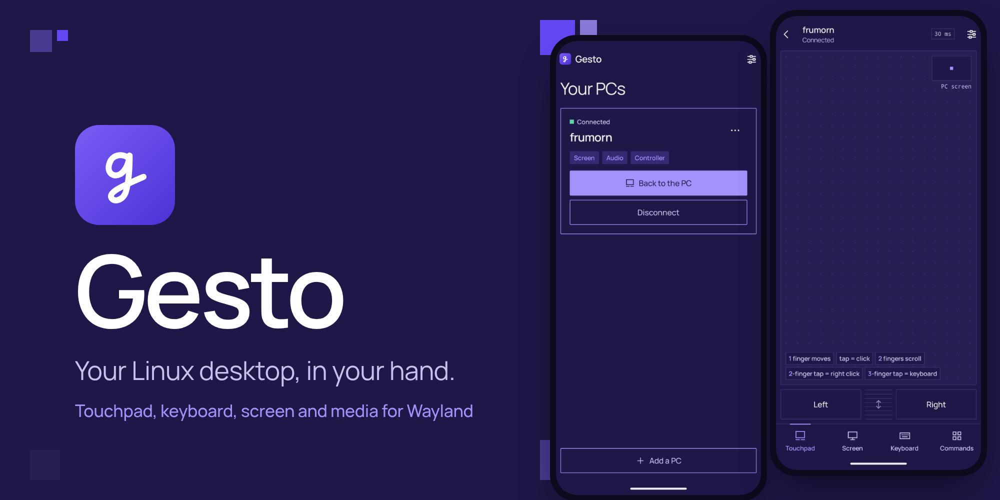
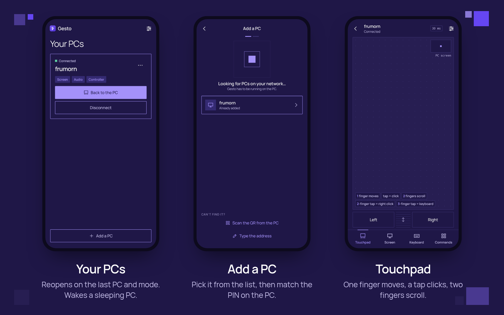
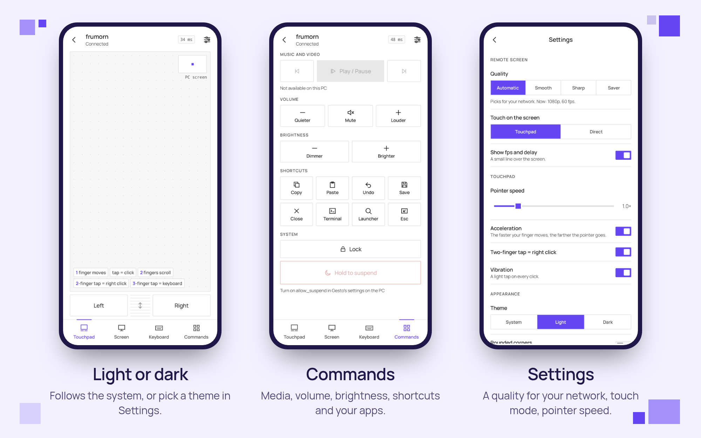

<p align="center">
  
</p>

<p align="center">
  <a href="LICENSE"></a>
  
  
  
  
</p>

**Gesto** turns your Android phone into a touchpad, keyboard, remote screen and media remote for your Linux desktop. It was called Waypad until 0.1.

On the PC it talks to [Gesto for Linux](https://github.com/Frumorn12/gesto-linux), a small service that runs as your user. Both are made for Wayland, with Hyprland as the home desktop. The phone connects straight to your PC over an encrypted channel: there is no cloud in between.

No accounts, no ads, no analytics.

<p align="center">
  
</p>

## Why "Gesto"

*Gesto* is Italian for gesture: a movement of the hand that means something. That is how you use the app: a finger moves the pointer, a tap clicks, two fingers scroll, a three-finger tap opens the keyboard. Even adding a PC usually takes a gesture rather than a code: one tap on **Allow**, on the PC.

## Features

### Your PCs
- **Opens where you left off**: on the last PC and the last mode you used.
- Each PC shows whether it is **online** on your network and what it offers: screen, audio, controller.
- **Wake-on-LAN**: an offline PC has a **Wake** button. It works when the PC is on a wired network with wake-on-LAN enabled.
- **Launcher shortcuts**: long-press the Gesto icon to connect straight to one of your PCs.
- Rename or forget a PC from its menu.

### Add a PC
- PCs running Gesto for Linux on your network show up in a list. Pick yours: the phone shows a **4-digit PIN** and the PC shows a notification with the same PIN. Check that they match and press **Allow** on the PC.
- If the PC can't show that notification, type the 6-digit code from `gesto pair`, scan the QR code it prints, or type the PC's address.

### Touchpad
- One finger moves the pointer, a tap clicks, a two-finger tap right-clicks, two fingers scroll.
- Hold, then move, to drag. A three-finger tap opens the keyboard.
- Left and right buttons and a scroll strip under the pad, and a small map of roughly where the pointer is on the PC's screen.
- Pointer speed and acceleration in Settings.

### Keyboard
- A sheet over the touchpad, the screen or Commands, with **Ctrl, Alt, Super and Shift** that stay pressed for the next key, plus Esc, Tab, the arrows, Enter and Backspace.
- What you type in its text field reaches the PC as you type. When you pick a suggestion or a correction, only the text from the change onwards is typed again.

### Screen
- The PC's screen on your phone, as a **hardware H.264** stream at up to 60 fps, with the **desktop's sound**.
- Touch it as a **touchpad** (your finger moves the pointer, a tap clicks where the pointer is) or **directly** (a tap clicks where you touch; hold first to drag).
- **Pinch to zoom**. Turn the phone sideways and the screen goes full screen, with only the purple button left on top.
- The purple button opens the **quick menu**: right click, PC audio, touch mode, quality, game mode, and the way back to the touchpad or to your PCs.
- **Game mode**: 60 fps, full screen, and a **controller** connected to the phone plays as a gamepad on the PC. A keyboard or mouse connected to the phone works on the PC too.

### Commands
- **Music and video**: previous, play or pause, next. **Volume** and **brightness**.
- **Shortcuts**: copy, paste, undo, save, close, terminal, launcher, Esc.
- **Apps on the PC**: the ones you list in the PC's config, one tap to start each.
- **Lock** the PC, or **hold to suspend** it (if the PC allows it).

<p align="center">
  
</p>

### Settings
- **Quality** of the screen: **Automatic** picks one for your network and steps down when it slows; **Smooth** is 60 fps, for games; **Sharp** keeps text readable at 30 fps, for work; **Saver** is 720p at 30 fps. Under Advanced you set fps, resolution, encoder quality and the PC's screen by hand.
- Touch mode, an fps and delay line over the screen, pointer speed, acceleration, two-finger right click, vibration.
- **Light, dark or system theme**, and rounded corners if you like them softer.
- **Diagnostics** shows the connection, input, screen and audio, for when something does not work.
- In **English and Italian**, following the phone's language.

## Install

| What | Where | Notes |
| --- | --- | --- |
| **Gesto**, this app | [GitHub releases](https://github.com/Frumorn12/gesto/releases) | Signed APK to install by hand. |
| **Gesto for Linux**, on the PC | [Frumorn12/gesto-linux](https://github.com/Frumorn12/gesto-linux) | One binary, `gesto`, run as a systemd user service. A PKGBUILD for Arch is included. |

Gesto needs **Android 8.0 or newer**.

Coming from Waypad 0.1: Gesto is a new app (`it.frumorn.gesto`), so it installs next to Waypad. Add your PC again from Gesto, then uninstall Waypad. On the PC, Gesto for Linux takes over waypad-daemon's identity and settings by itself.

## Set up your PC

1. Install [Gesto for Linux](https://github.com/Frumorn12/gesto-linux#install) and start it:

   ```sh
   systemctl --user enable --now gesto
   ```

2. Run `gesto` in a terminal. It tells you whether the service is running, the PC's address on your network and which phones are paired.
3. On the phone, tap **Add a PC** and pick your PC. A notification appears on the PC with the same PIN as the phone: press **Allow**.

That's it. The service starts with your desktop session from then on.

To start apps from the Commands screen, list them in `~/.config/gesto/config.json` on the PC; suspend is off until you turn on `allow_suspend` there. The [Gesto for Linux README](https://github.com/Frumorn12/gesto-linux#launching-apps) has the details. If something does not work, `gesto doctor` checks the Wayland session, portals, screen capture, audio, input and network, and [docs/TROUBLESHOOTING.md](docs/TROUBLESHOOTING.md) covers the usual problems.

## Pairing and security

- **Someone at the PC has to say yes.** A phone pairs only after **Allow** is pressed on the PC's notification, or with the one-time code that `gesto pair` prints there. By default a new phone can only pair from the local network.
- **The control channel is encrypted**: P-256 key exchange (ECDH), a handshake signed by the PC's host key, HKDF and AES-GCM frames. The app pins the host key when it pairs and refuses to connect if it changes.
- **The phone's token for each PC is encrypted** with a key kept in the Android Keystore, and left out of Android backups.
- **The screen and sound stream** is protected by a one-time token but is not encrypted like the control channel: use it on your own network or through a VPN.
- No accounts and no servers of ours: Gesto only talks to your PCs. The QR scanner uses Google's [ML Kit](https://developers.google.com/ml-kit/vision/barcode-scanning), which reads the code on the phone.

Wire details are in [docs/PROTOCOL.md](docs/PROTOCOL.md), the app's structure in [docs/ARCHITECTURE.md](docs/ARCHITECTURE.md). To report a vulnerability, see [SECURITY.md](SECURITY.md).

## Building

You need JDK 17 or newer and the Android SDK (platform 36).

```sh
export ANDROID_HOME=$HOME/Android/Sdk
./gradlew assembleDebug testDebugUnitTest
./gradlew assembleRelease
```

The release build is signed when `~/.config/gesto/firma.properties` exists, with `storeFile`, `storePassword`, `keyAlias` and `keyPassword`. Without it, the release APK comes out unsigned. The key never goes in the repository.

The code, comments and commit messages are in English. See [CONTRIBUTING.md](CONTRIBUTING.md).

## Thanks to

- [Moonlight](https://moonlight-stream.org) and [Sunshine](https://github.com/LizardByte/Sunshine), for ideas: the quick menu during a stream, gesture thresholds, pairing approved on the PC, quality presets.
- [Jetpack Compose](https://developer.android.com/compose) and [CameraX](https://developer.android.com/media/camera/camerax) (Apache 2.0)
- [ML Kit barcode scanning](https://developers.google.com/ml-kit/vision/barcode-scanning), for the QR code
- [Manrope](https://github.com/sharanda/manrope) by Mikhail Sharanda (SIL Open Font License, [docs/OFL-Manrope.txt](docs/OFL-Manrope.txt))

## License

[MIT](LICENSE): use, modify and redistribute Gesto however you like, including in commercial projects, as long as you keep the copyright notice.
